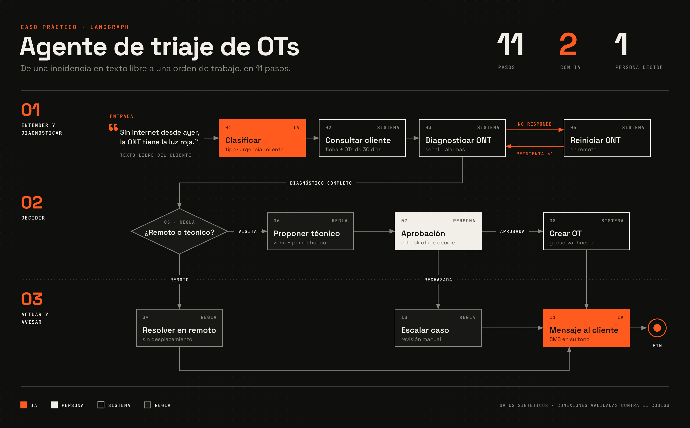

# Agente de triaje de OTs con LangGraph

Ejemplo práctico de un agente de IA para operaciones de campo: recibe una incidencia en texto libre, la clasifica, consulta datos del cliente, diagnostica la línea, decide si se resuelve en remoto o hace falta un técnico y, **antes de mandar a nadie, pide aprobación a una persona**.

Todos los datos son sintéticos.



## Qué enseña este ejemplo

| Concepto de LangGraph | Dónde se ve |
|---|---|
| **Estado** compartido | `Estado` en `triaje/grafo.py`: cada paso lee y completa el mismo diccionario |
| **Nodos** | Cada paso es una función Python normal |
| **Aristas condicionales** | `decidir` → remoto o visita; `aprobacion_humana` → aprobada o rechazada |
| **Bucles** | Si la ONT no responde: reiniciar y volver a diagnosticar |
| **Human-in-the-loop** | `interrupt()` en `aprobacion_humana`: el grafo se para hasta que alguien decide |
| **Persistencia** | `SqliteSaver`: un caso pausado se retoma desde otro proceso, horas o días después |

Una decisión de diseño importante: **el LLM solo se usa donde aporta** (entender el texto libre y redactar el mensaje al cliente). La decisión de enviar un técnico la toman reglas explícitas y una persona, no el modelo.

## Cómo ejecutarlo

```bash
python -m venv .venv && source .venv/bin/activate   # en Windows: .venv\Scripts\activate
pip install -r requirements.txt
```

**Sin API key** funciona en "modo demo" (reglas simples en lugar del LLM). Para usar Claude, copia `.env.example` a `.env` y pon tu clave de Anthropic.

```bash
# Los 4 escenarios de ejemplo de principio a fin (guarda la traza en salidas/trazas.txt)
python demo.py

# Una incidencia propia, con aprobación interactiva en el terminal
python main.py "C-1002: sin internet desde ayer, la ONT tiene la luz LOS en rojo"

# Pausar, cerrar, y retomar más tarde desde otro terminal
python main.py --pausar "C-1002: sin internet desde ayer, luz LOS en rojo"
python main.py --pendientes
python main.py --retomar caso-xxxxxx --aprobar
python main.py --retomar caso-xxxxxx --rechazar --comentario "Que lo revise ingeniería"

# Regenerar el diagrama: requiere rsvg-convert y las fuentes de fuentes/ instaladas.
# Falla si el dibujo no coincide con el grafo del código.
python diagrama.py
```

## Los 4 escenarios de la demo

1. **Lentitud** → la línea está bien, el wifi está saturado → se cambia de canal en remoto.
2. **Sin conexión** → la ONT no responde → reinicio remoto → se vuelve a diagnosticar → resuelto.
3. **Avería física (LOS)** → propone técnico y hueco → el back office aprueba → se crea la OT.
4. **Cliente reincidente** → propone técnico, pero avisa de 2 visitas en 30 días → el back office rechaza y lo escala.

## Estructura

```
triaje/
  datos.py         datos sintéticos (clientes, histórico, red, técnicos)
  herramientas.py  funciones que simulan los sistemas (CRM, red, planificador)
  llm.py           clasificación y redacción con Claude, o modo demo
  grafo.py         estado, nodos, aristas y construcción del grafo
main.py            uso interactivo y pausa/reanudación
demo.py            ejecuta los 4 escenarios
diagrama.py        genera salidas/grafo.png y valida sus conexiones contra el grafo real
fuentes/           Space Grotesk y JetBrains Mono (licencia OFL) para el diagrama
```

## Siguientes pasos naturales

- Sustituir `herramientas.py` por llamadas reales al FSM, CRM y sistema de red.
- Poner la aprobación en una interfaz (Slack, Teams o una web) en vez del terminal.
- Cambiar SQLite por PostgreSQL para varios usuarios a la vez.
- Medir: % de incidencias resueltas sin desplazamiento, tiempo de triaje, % de propuestas que el back office corrige.
